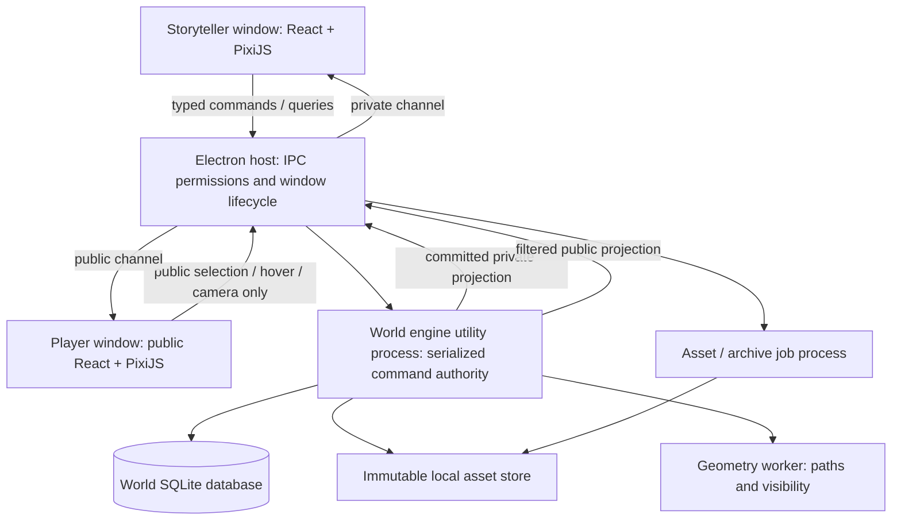

# Application architecture

Status: architecture baseline adopted for the initial implementation. The user authorized implementation; A03's Windows two-window/native-module/WebGL compatibility proof is complete. See IMPLEMENTATION_STATUS.md for evidence and limitations. Later architecture sections describe work still to build. Product decisions remain governed by PLANNING_INDEX.md and its linked specifications; implementation does not resolve unapproved gameplay behavior.

## 1. Architecture decision

Build a local Windows desktop application as a **modular monolith with one authoritative world engine and two isolated presentation windows**.

| Concern | Recommended technology | Reason / constraint |
| --- | --- | --- |
| Desktop host | Electron | Two native application windows, local file access, monitor/fullscreen control, Windows appearance, shared TypeScript tooling |
| Language | TypeScript with strict checks | Shared domain types across engine, rules, geometry and presentation; runtime validation still required at process/storage boundaries |
| Management UI | React + ordinary HTML/CSS | Dense forms, tables, collapsible sheets and floating inspectors; no decorative component/theme framework |
| Map | PixiJS 8, explicitly prefer WebGL | GPU-backed 2D scene; shared rendering code for two windows, independent scene instances and cameras; do not assume a Canvas fallback exists |
| Persistence | SQLite through better-sqlite3, in a utility process | Atomic domain commits, indexed queries and revision storage without blocking the UI process; native module packaging must be proved early |
| Rich text | Tiptap core/open extensions, persisted as structured JSON | Headings/lists/images/record links without arbitrary executable HTML; no hosted collaboration dependency |
| Asset conversion | sharp/libvips in a separate job process | Original preservation, thumbnails and tiled image pyramids; avoid whole-image GPU textures |
| Build/distribution | Electron Forge, Vite-based UI build, npm workspaces | One repository and reproducible Windows installer; exact package versions pinned after compatibility proof |
| Validation/testing | Runtime schema validation; Vitest for domain tests; Playwright Electron integration | Validate commands/content and test actual two-window/recovery behavior |

This is the recommended stack, not an assertion that all dependency versions have been compatibility-tested. Pin versions and native ABIs in the first implementation milestone; never install floating latest dependencies in packaged builds.

Tradeoffs: Electron has a larger install and idle memory footprint than a native toolkit. It reduces cross-language boundaries for this form-heavy application and rules engine. SQLite is intentionally local; direct shared-folder multiwriter access is not supported. High history/image retention consumes disk space, which must be visible to the user.

Alternatives considered:

- **Tauri/Rust:** smaller shell, but adds a second implementation language and more serialization boundaries for rules/geometry/image work. Reconsider only if measured Electron overhead fails agreed hardware goals.
- **WPF/.NET:** strong native Windows integration, but a separate map/editor stack and less direct sharing with possible future browser player clients.
- **Browser-only/PWA:** weaker fit for the required file management, native two-window lifecycle and portable worlds.
- **Server/cloud/microservices:** unnecessary for offline single-PC MVP. Do not introduce accounts, HTTP services, background network dependencies or separate deployments.

## 2. Process and dependency boundaries



**Host/main process:** creates windows, handles OS dialogs/monitor state, assigns window roles, routes narrow IPC contracts, controls jobs, and publishes committed updates. Never performs long image conversion/pathfinding/database work on the main event loop.

**World engine:** owns canonical world state, session membership/reservations, command validation, rule resolution, durable revision/history records, projected query state, campaign clocks and staged transitions. One writer queue per open world. MVP has one active world engine; switching worlds closes/checkpoints the previous engine after any required jobs complete. Frozen player presentation does not require a second live engine.

**Geometry worker:** pure computation over immutable geometry snapshots; returns revision-tagged paths, costs, collisions, visibility polygons and hit-test data. Engine validates the current revision before accepting results. Cancellation/latest-request behavior prevents stale drag results replacing newer previews.

**Asset/archive jobs:** bounded, cancellable background work. Jobs write only to engine/host-authorized staging paths. They do not mutate game records or independently decide that an import/restore succeeded.

**Renderers:** receive view models and keep only local interaction state. They never access SQLite or arbitrary filesystem paths. Domain/rules code does not import Electron, React or PixiJS. A renderer crash cannot corrupt authoritative state.

## 3. Repository modules

Proposed source layout; do not create application packages until implementation is requested.

```text
apps/desktop/
  main/                     # host, window roles, lifecycle, job orchestration
  preload/                  # separate storyteller/player bridges
  storyteller/              # Home, tabs, management editors, Play controls
  player/                   # public scene, initiative, public hover/HP panels
packages/
  contracts/                # runtime schemas, IPC DTOs, command/result envelopes
  domain/                   # IDs, aggregates, invariants, clocks, policies
  engine/                   # commands, resolution continuation, projections
  persistence/              # SQLite repositories, revisions, migrations, leases
  rules/                    # deterministic mechanics and structured content DSL
  geometry/                 # continuous geometry, cost routing, visibility
  map-view/                 # Pixi scene adapters, hit testing, camera transforms
  content/                  # pinned SRD catalog, custom schemas, coverage manifest
  assets/                   # import manifests, hash storage, tile jobs
  recovery/                 # backups, import/export, restore, Trash operations
  ui/                       # neutral controls, tables, sheets, inspector manager
tests/
  fixtures/                 # synthetic worlds, mechanics examples, image fixtures
  integration/              # database, jobs, IPC, crash and recovery checks
  e2e/                      # packaged app and two-window workflows
```

Dependencies point inward: UI → contracts → engine/domain; engine → repository interfaces, rules and geometry interfaces; persistence implements repository interfaces. Only desktop adapters know Electron. Avoid one service per menu: menus are views into shared domain modules.

## 4. Data ownership and identities

Use opaque IDs, qualified by a world instance at IPC/UI boundaries. Names never identify records. Imports/restores get new world-instance IDs while preserving internal record IDs/links inside that separate world; commands cannot accidentally address the source world.

| Aggregate | Owns |
| --- | --- |
| World | Canonical entities/NPCs, locations/lore, campaigns, shared references, record revisions and reservation ownership |
| Campaign | One party roster, independent clock, campaign definitions/settings, sessions, prepared encounter references |
| Session | Ordered action groups, status, membership, continuation reference, resolution/checkpoint metadata |
| Entity | Persistent HP/resources/inventory/features/effects and private/public identity fields, as approved by field schema |
| Location / area template | World location data and versioned authored map/drawing/wall/terrain configuration; exact location-to-area cardinality remains a product/schema decision |
| Encounter | Instance geometry/placements, initiative, round/turn, spent movement/action state, encounter-scoped effects |
| Placement | References canonical entity; position/footprint/elevation and encounter presentation, never an independent hidden copy of its HP |
| Staging draft | Base revisions, intended record changes, destination setup, generated entity drafts, player-camera preview; no live mutation before Start |
| Content definition | Immutable version of preset/profile/item/spell/class/species/etc.; explicit source/version references |
| Asset | Immutable original bytes, hash/metadata; historical usage references and regenerable derived caches |
| Shop / loot table | Authored tier/chance/price entries, persistent finalized stock, separate autosaved generation draft |

Canonical world entities differ from global reusable templates: copying a template generates a new entity identity; placing a world NPC references the existing identity. Prevent unintended duplicate live placement of one canonical creature through a policy check, whose final allowed cases require specification.

## 5. Physical storage

```text
application-data/
  catalog.sqlite            # registered world paths, Trash registry, operation recovery
  ui-state.json             # app preferences/window/tab/inspector state; no game history
  global-library/           # versioned reusable definitions + immutable assets

chosen-world-folder/
  world.sqlite              # all campaigns, canonical records, history and draft data
  assets/sha256/<hash>       # immutable original/history-referenced bytes
  derived/                  # thumbnails/pyramid tiles: disposable, rebuildable
  manifests/                # versioned world identity/schema and operation metadata
```

Backups and Trash may use configurable locations managed by the catalog. A world owns all dependencies needed for standalone full-world export; no archive requires a path into the global library to remain functional.

Use normalized indexed columns for relationships/filters and versioned structured payloads for content/rules documents. Important table groups: worlds/campaigns/sessions, records/current versions, placements/encounters, definitions/versions, memberships/reservations, drafts, journal transactions/record revisions, session actions/resolutions, assets/references, snapshots and persistent jobs. Actual SQL schemas follow the approved field contract.

SQLite configuration recommendation: foreign keys on; WAL for working databases; FULL synchronous durability for acknowledged commits; explicit transactions and bounded busy handling. Store on a local supported filesystem. Prove power-loss/crash behavior and performance on the selected Windows build. SQLite WAL is a storage implementation detail, **not retained product history or a backup strategy**.

No routine direct copying of an open database file. Produce database snapshots using SQLite's consistent backup API; capture an associated asset manifest at the same logical revision. Keep asset references immutable so content cannot disappear mid-backup.

## 6. One durable command pipeline

Every game/content mutation goes through the engine, including inspector edits, rich text saves, World Manager changes, clocks, session completion, draft updates and shop finalization.

1. Receive `{commandId, worldInstanceId, actorWindowRole, sessionId?, expectedRecordVersions, payload}` through a validated bridge.
2. Resolve role capabilities, world binding, membership/reservations and schema validity. Reject stale revisions with a structured conflict; no last-writer-wins overwrite of gameplay records.
3. Evaluate rules/geometry and construct a proposed mutation set. Obtain required choices/rolls through the persisted resolution mechanism below.
4. Commit current record updates, immutable revision/history entries, session action membership, reservation changes and command deduplication record in **one SQLite transaction**.
5. Publish new private/public projections only after commit. Return the committed revision. UI shows Saving/Pending until durable acknowledgement, then Saved.
6. Retry with the same command ID returns the original outcome instead of rolling/spending twice.

Continuous drag/hover is transient preview, not repeated durable movement. Numeric/text edits save through explicit editor adapters: text documents persist incremental changes; numeric inputs can retain an incomplete raw draft while only validated values affect rules. No partial number becomes HP zero by accident.

## 7. Durable history, undo, and whole-world restoration

Use **transactional current-state tables plus an immutable revision journal and checkpoints**. Avoid requiring historical rules code to rerun to recover a world.

Each durable transaction records its ID, ordered world revision, origin/session, schema version, touched records, previous/new record revisions, change payloads or immutable before/after document references, outcome/roll/ruling references, logical action group, campaign-clock changes and asset references. Capture creation/deletion and preparation/draft edits as well as combat.

The internal ordered revision establishes causality for shared records and restore points. It is not a user-facing flat campaign action history: session gameplay history is a session-owned index of its action groups; world/campaign history presents session lists. World Manager/content changes have durable revisions without being mislabeled as session combat actions.

**Session undo/redo:** an action group includes all its linked consequences. Reverse it only inside its session and only if touched records/dependent state can be changed without overwriting newer external changes. Append a reversal/reapplication transaction; never rewrite finalized source events. Keep a session history cursor/redo eligibility. A new action invalidates undone future as a redo option; retain its old revisions for recovery/audit without exposing gameplay branches.

**Completed history:** completing seals session action history. Continue creates a new session ID/reference and initializes from present canonical state. It does not restore the old checkpoint.

**Replay:** build a read-only replay state from recorded state/changes and historical visibility/content/asset versions. Resolve no dice and execute no modern rules during playback. Keep replay windows/contexts incapable of world commands. Seek uses checkpoints plus a suffix of recorded revisions; do not load the entire world history into UI memory.

**World restore:** at a selected durable revision, create a new world from a compatible checkpoint plus recorded changes through that revision. Preserve the source and all later history unchanged. Restore includes notes/templates/shops/images/setup drafts, not hover/tab-focus/inspector presentation. Include state sufficient for restored incomplete sessions/reservations to be internally consistent. Newly assigned world-instance identity prevents source/restored record cross-talk.

Checkpoints are derived acceleration structures, never authorization to prune required history. Creating separate restored worlds is recovery, not an in-app timeline branching feature.

## 8. Long actions, reactions, randomness, and clocks

Rules functions accept explicit inputs and return effects or a continuation asking for choice/roll. Avoid UI callbacks embedded inside rules code. A persistent resolution stack carries action origin, targets, trigger ordering, decisions, consumed RNG results and expected versions.

No database transaction remains open while waiting for storyteller input. Persist progress as a recovery draft, then revalidate before committing a phase. Completed roll records are immutable and never regenerated after a crash. In-flight drafts must distinguish unused generated rolls from already committed world effects.

Movement can legitimately commit a traveled segment before a reaction/check halts the rest. Use durable phases under one logical action group, publish each acknowledged phase, and link all phases for whole-action undo. Do not pretend that an interactive multi-minute action is one uninterruptible database transaction. Recovery resumes or safely stops from the last committed phase; it cannot revert acknowledged partial travel or reroll resolved checks silently.

Use a host-provided RNG adapter, injecting fixed rolls/seeds in tests. Record actual results, decisions, content versions and order; a seed alone is insufficient for cross-version replay. Include shop shuffles/rolls and generation provenance, with actual draft output saved.

Campaign time is explicit simulation time, not Date.now(). Effects reference their origin campaign clock or turn trigger and source entity/session. Wall-clock time exists only for metadata. **Product decision still open:** what happens to an unexpired campaign-clock effect when its canonical entity later participates in another campaign with a different clock. Store origin/remaining/trigger fields now, but do not silently choose rebasing or duplicate clocks.

## 9. Two windows and public projection

Use two BrowserWindows with separate entry points/preloads and renderer roles. Node integration off, context isolation and sandbox on, local-only application resources. Validate IPC sender identity and command schema in the host; never infer authority from a submitted role string.

Storyteller receives private projection. Player receives only a deliberately constructed public scene/initiative/condition/selection projection. Never send full entity objects and hide private fields with CSS. Public hit tests, hover previews, asset manifests and inspector DTOs must also exclude hidden entities/private data.

Player capabilities: permitted public hover/selection, its local camera and party-only HP panel. Player cannot call entity edits, pin private sheets, clock changes, dice, filesystem or generic queries. Storyteller edits do not select player tokens. Player selection/hover forwards to storyteller using IDs validated against the current public scene.

All messages carry `worldInstanceId`, `sceneEpoch`, `revision` and view context (live/staging/replay/frozen). A newer scene epoch invalidates pending old input. Resync after missed revisions uses a full filtered snapshot; stale hover/click events cannot select a same-named entity in a new world.

Public asset delivery uses a role/scene-bound protocol, not raw disk URLs or a list of every world asset. If map pixels themselves contain unrevealed content, generate/cache fog-composited public tiles for that visibility revision rather than handing the player renderer an unrestricted original. Public token/terrain assets must not expose hidden-record names through filenames/metadata. The trust boundary is the application projection, not protection against the PC owner inspecting their own disk.

Publication states:

- **Live:** committed public updates and approved one-way interaction forwarding.
- **Preparing new map:** hold last public scene and Selecting new map indicator; private draft and player-camera preview remain unseen.
- **Frozen other campaign:** retain old public snapshot; allow player pan/zoom; no forwarding or live-record commands.
- **Start:** validate draft base versions/reservations/capacity, atomically commit setup and outbox scene publication; then publish new epoch/camera. If commit fails, keep old public scene and draft intact.
- **Cancel:** resume previous live context; Keep Draft or confirmed discard. Do not reset game time/state.
- **Replay:** read-only historical public projection, never current secret data.

Maintain a durable public presentation snapshot/asset manifest for startup and frozen cross-world viewing. No need to hold the old world database open. Exact freeze-time player camera behavior during new-map staging remains a UI policy to confirm; cross-campaign pan/zoom behavior is already approved.

## 10. Map, geometry, and image pipeline

Keep the square grid a display/snap aid, not the storage/pathfinding resolution. World geometry uses fractional feet with deterministic documented comparison tolerance. Display precision is 0.1 ft; it does not force 0.1-ft cell storage.

Pixi scene layers: map tile imagery, public drawings/terrain, fog masks, tokens, conditions/state markers, movement/target templates and labels; private mechanical/editor layers only in storyteller. Render DOM inspectors/sheets separately for readable text and keyboard input. Use spatial indices, viewport culling, bounded GPU texture caches and layer invalidation. A square-mile area never allocates one giant canvas or per-0.1-ft grid. Idle scene drawing should stop unless input/state changes.

Geometry design:

- Polygon/segment model for terrain, walls, doors and obstacle height; token footprints inflate forbidden regions for routing and clearance checks.
- Routing derives a sparse navigation representation from geometry, not the displayed grid. Cost mode evaluates terrain-weighted path cost; distance mode minimizes geometric length then reports terrain cost. Hard waypoints divide segments; Over/Through have their own validated traversal adapters.
- Compute visibility from wall/door/radius geometry and combine party vision; store explored memory in a sparse/tiled representation. Historical revelation changes must be reconstructable, not replaced by current fog data.
- A*/graph or navmesh search can accelerate routes, but exact continuous least-cost routing through weighted polygons is nontrivial. Before committing to a geometry library, prove weighted routes, footprints, boundary costs, no-route behavior and 0.1-ft placement on adversarial fixtures. Do not label ordinary uniform-grid A* the exact required continuous optimum. Any approximation/tolerance needs explicit documented acceptance.
- Over delegates climb/jump/fly costs and rolls to rules; numeric elevation does not require a 3D renderer. No full lighting/special-sense engine in MVP.

Image flow: import to temporary file → inspect metadata/resource needs → hash/copy immutable original → generate thumbnail and tiled zoom pyramid in a bounded worker → commit asset references → load only visible tiles. Preserve originals and historical versions; derived tiles can be rebuilt. sharp is the recommended conversion adapter, subject to packaged native-library validation.

No arbitrary fixed product image-size cap, but decoder/OS/GPU limits still exist. Preflight huge dimensions, cap concurrent conversion memory, support cancellation and low-resolution preview, and give recoverable unsupported/resource-limit errors. Do not blindly disable decoder safeguards or upload originals as unlimited GPU textures. File formats and corrupt/malicious input handling are part of the import contract.

## 11. Content, character progression, and rules engine

The user has selected published Open5e 2024 JSON as the planned data source. Follow CONTENT_DATA_PLAN.md and S01→S02→S03 tasks in WORK_BOARD.md; preserve the additional prerequisites on each task. Pin an immutable upstream commit, retain license/provenance, and audit upstream SRD 5.2 metadata against our 5.2.1 baseline. Acquire repository JSON without scraping webpages. Bundle validated normalized data for offline use; do not add a live API dependency or general importer UI. Imported records and implemented executable mechanics have separate completion states.

Bundle pinned SRD 5.2.1 content plus attribution, immutable IDs and structured versions. Maintain a coverage manifest with enabled/deferred reason, handler schema, prerequisites, progression effects and acceptance fixtures per feature/spell. Only lighting/sense dependencies are approved broad exclusions; unrelated hard mechanics cannot be quietly moved to manual mode.

Rules are structured validated data and trusted TypeScript handlers, not user-supplied eval/scripts. Common primitives cover roll/attack/save, defense-aware damage/healing, resources/actions, modifiers/conditions, areas/terrain, recurring triggers, concentration and prompted judgments. Complex enabled mechanics can use dedicated trusted handlers with their own coverage tests; a generic damage schema is not complete automation.

Character progression is a level-by-level choice ledger, including multiclass choices and explicit storyteller overrides. Derived sheet computation is deterministic against pinned definitions; materialized sheet values are query projections. Do not infer player choices by diffing final ability scores. Variant generation uses immutable source definitions/profile references and explicit overrides; exact transformation/rounding/damage rules remain a product decision.

Rich-text documents store schema-validated JSON with internal record/asset IDs. Render through trusted components; sanitize any HTML import/export and never execute embedded content. Global library version updates explicitly copy dependencies into a world/campaign definition set; existing generated entities/live templates/history are not rewritten automatically.

## 12. Backup, import/export, Trash, and migrations

**Required backup gate:** serialize New Session/Restore through a world write barrier. Flush acknowledged editor commands, take a consistent SQLite snapshot and immutable asset manifest, verify complete backup, then permit operation. On failure retain current state and offer Retry/Choose Backup Folder; no silent bypass. Use command IDs so retry cannot create duplicate sessions.

**Archive:** a versioned manifest plus database snapshot, referenced original assets, history/revisions and durable drafts. Derived caches and transient UI layout need not be exported. Use streaming ZIP as recommended container; archive library choice follows compatibility checks. Validate hashes/links/schema and extract into an owned staging directory, rejecting traversal paths/symlinks. Register the imported/restored world only after validation succeeds; source never changes.

**Asset/database atomicity:** write immutable assets to a staging filename, flush/rename into hash store, then commit references. Crash may leave an unreferenced asset but cannot leave an acknowledged reference to an unpublished file. Historical references prohibit destructive asset deletion; cache eviction is separate from original/history removal.

**Trash:** close world/asset handles, move world and associated backup ownership into managed Trash without deleting shared/global originals still needed elsewhere. Cross-volume moves are copy/verify/commit/remove operations with resumable intent records; do not assume rename atomicity across drives. App catalog and filesystem do not share an SQLite transaction, so persist operation phases and recover them after restart. Confirmed Empty Trash operates only on validated Trash-owned targets; never follow arbitrary manifest paths into another world/global library.

**Migrations:** version world schema, content schema and archive format separately. Migration writes to a temporary/copy database with a recovery snapshot, validates it, then swaps registration only on success. Keep immutable historical payloads readable through version adapters; do not destructively rewrite old outcomes to current rules. Refuse modification of unsupported newer formats with an explanation.

**App UI persistence:** windows/tabs/inspector positions/density/shortcuts live outside world history. Clamp recovered positions to available monitor bounds. Durable map setup/player-camera preview belongs to draft state and therefore world restoration; transient inspection cameras do not.

## 13. Validation and performance gates

Tests must establish outcomes, not merely mirror implementation:

- Single command updates canonical state and immutable history atomically; retry cannot duplicate results.
- Inter-session reservation enforcement and whole-action undo/redo refuse stale external overwrites.
- Completed replay reproduces actual dice/outcomes/visibility after definitions and world records change.
- Crash during a committed movement phase resumes without duplicate costs/rolls; crash before acknowledgement cannot claim Saved.
- Staged party HP stays isolated; failed Start never leaks destination/partial setup; stale base revisions surface conflicts.
- Player process never receives hidden IDs/private HP through scene, initiative, hover, assets, targeting or IPC queries.
- Snapshot/restore reconstructs notes/assets/shops/drafts and session status, not just combat HP. Source/later history remain unchanged.
- Backup failure blocks New Session/Restore; retries are idempotent. Import same world twice without changing source/internal relationships. Trash never deletes active-world assets.
- Geometry cases cover narrow gaps, large footprints, terrain overlaps, diagonal/fractional travel, mixed modes, reactions mid-route and unreachable cursor positions.
- Packaged Windows smoke test includes native SQLite/image libraries, two 4K/1080p mixed-DPI windows, maximum map extent, 100 entities, long history and offline first launch.

Instrument frame time, geometry-request latency, commit latency, memory/texture cache, backup/archive time and history size. Initial engineering targets, to validate on documented baseline hardware: smooth direct manipulation at 1080p/4K, no unbounded main-thread job, newest valid drag result wins, bounded tile/geometry working sets. Set numeric release budgets only after representative hardware/fixtures are agreed; these are not universal performance guarantees.

## 14. Known decisions needing product clarification

Architecture can accommodate these without silently deciding them:

1. Exact session state table and staged-resource reservation timing. Recommendation: durable Draft/In Progress/Complete plus ephemeral focused-recording state; completion releases reservations. Acquisition during draft setup needs approval.
2. Ownership/transfer/expiry of effects across independent campaign clocks.
3. Exact preset modifier arithmetic/dice rounding, manual roll inputs, resource overspend representation and simultaneous-trigger choice ordering.
4. Which persisted location/area changes are canonical world changes versus campaign/template/encounter state; record identity versus generated duplicate rules.
5. Restored history prefix when target is inside a finalized session, recovered reservation status, and user-facing naming of restored/imported worlds.
6. Quantified routing optimality tolerance and performance baseline; supported image formats and handling of decoder limits.
7. Remaining exact editor fields/content catalog, character progression behavior and visual screen contracts.

These are product specification gaps, not permission to choose arbitrary behavior while implementing. Technical implementation choices such as SQL indexes and tile-cache eviction need not become user-facing approval questions.

## 15. Primary technical references

Consulted during architecture planning; choices above are design judgments, not vendor guarantees.

- [Electron security and IPC isolation](https://www.electronjs.org/docs/latest/tutorial/security)
- [Electron utility processes](https://www.electronjs.org/docs/latest/api/utility-process)
- [SQLite consistent backup API](https://www.sqlite.org/backup.html)
- [SQLite WAL behavior](https://www.sqlite.org/wal.html)
- [better-sqlite3 API](https://github.com/WiseLibs/better-sqlite3/blob/master/docs/api.md)
- [PixiJS renderer guidance](https://pixijs.com/8.x/guides/components/renderers)
- [sharp tiled output](https://sharp.pixelplumbing.com/api-output/#tile) and [input options/limits](https://sharp.pixelplumbing.com/api-constructor/)
- [Tiptap persistence](https://tiptap.dev/docs/editor/core-concepts/persistence)
- [Electron Forge packaging](https://www.electronforge.io/)
